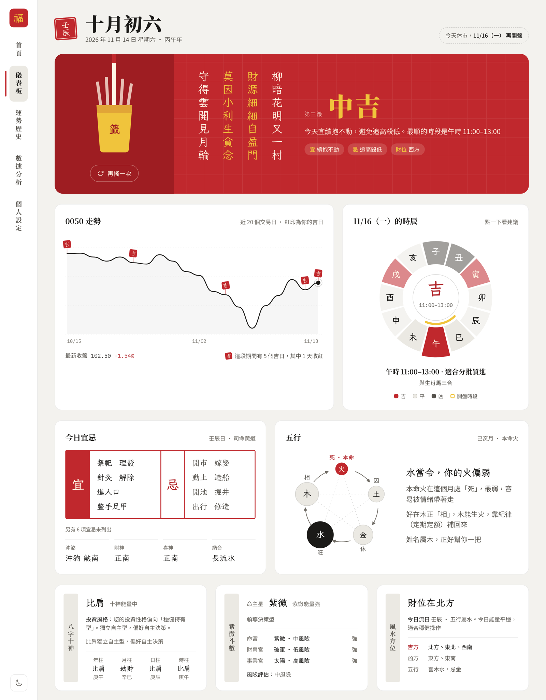
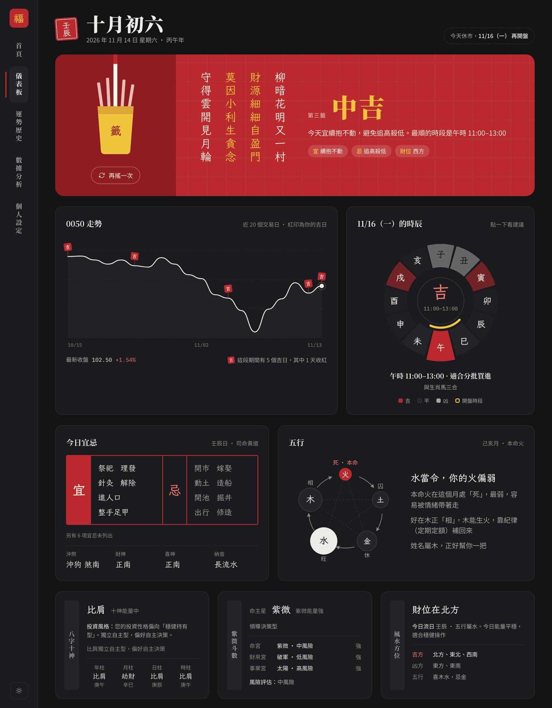
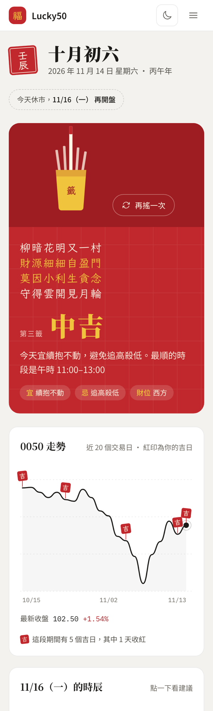

<p align="center">
  
</p>

<p align="center">
  
  
  
  
  
</p>

<p align="center">
  把傳統農民曆、八字與紫微，翻譯成一支看得懂的<b>每日投資籤</b>。<br />
  專為元大台灣 50（0050）設計，每天告訴你：哪個時辰下單最順、今天宜什麼、忌什麼。
</p>

<p align="center">
  
</p>

---

## 壹・今日籤上寫了什麼

| 版面              | 內容                                                                |
| ----------------- | ------------------------------------------------------------------- |
| 🎋 **今日籤**     | 搖一搖籤筒抽出籤詩與吉凶等第，附一句白話建議與「宜／忌／財位」      |
| 🕰 **十二時辰輪** | 依生肖三合與沖害推算每個時辰吉凶，金色弧線標出 09:00–13:30 開盤時段 |
| 📜 **今日宜忌**   | 農民曆宜忌（交易相關項目優先列出）、沖煞、財神、喜神、納音          |
| ☯ **五行生剋**   | 月令旺相休囚死，對照你的本命與姓名五行，說明今天該補什麼            |
| 🖌 **走勢吉印**   | 0050 近 20 個交易日水墨走勢，紅印標出你的吉日，看吉日與漲跌是否同步 |
| 🧭 **命理引擎**   | 八字十神、紫微斗數、風水方位三張卡片，與經典命理一起加權成綜合分數  |

<table>
  <tr>
    <td width="50%"></td>
    <td width="50%"></td>
  </tr>
  <tr>
    <td align="center"><sub>首頁・農民曆封面</sub></td>
    <td align="center"><sub>暗色模式・夜讀版</sub></td>
  </tr>
</table>

<table>
  <tr>
    <td width="33%"></td>
    <td width="33%"></td>
    <td>
      <b>手機也好翻</b><br /><br />
      桌面是直排書脊導覽；手機改成頂部列，選單以捲軸展開的方式<b>覆蓋</b>在頁面上，不推擠內容。<br /><br />
      所有頁面在 375px 寬度下沒有水平捲動。
    </td>
  </tr>
</table>

## 貳・設計語彙

介面以「一本翻開的農民曆」為主題，所有顏色都定義成 CSS 變數，亮暗兩套共用同一份 Tailwind 語意色。

| Token                     | 用途                   | 亮色      |
| ------------------------- | ---------------------- | --------- |
| `paper` / `surface`       | 宣紙底色／卡片         | `#f3f2ee` |
| `ink` / `ink-2` / `ink-3` | 墨色三階文字           | `#1b1a18` |
| `seal`                    | 朱紅印章、吉、強調     | `#c0282d` |
| `gold`                    | 籤筒、金字、開盤時段   | `#f0c43c` |
| `rise` / `fall`           | 台股慣例：**漲紅跌綠** | 紅／綠    |

- **字體**：Noto Serif TC（標題）、Noto Sans TC（內文）、霞鶩文楷 TC（印章與籤詩）、IBM Plex Mono（數字）
- **動態**：搖籤、時辰輪與選單展開都使用同一條 `--ease-out`，並尊重 `prefers-reduced-motion`
- **無障礙**：時辰輪支援方向鍵／Home／End，彈窗可用 Esc 關閉並歸還焦點

## 參・命理引擎

插件式架構，每個引擎實作同一個介面，由 registry 統一加權。權重可在「個人設定」調整並存在 localStorage。

| 引擎     | 預設權重 | 說明                             |
| -------- | -------- | -------------------------------- |
| 經典命理 | 30%      | 五行、生肖、星座綜合運勢         |
| 八字十神 | 25%      | 四柱十神推算投資性格             |
| 紫微斗數 | 20%      | 命宮、財帛宮、事業宮主星簡化分析 |
| 風水方位 | 15%      | 流日五行與吉凶方位               |

```typescript
interface MetaphysicsEngine {
  readonly name: string
  readonly description: string
  readonly version: string
  calculate(profile, date, lunarData, personalBaZi, elements): MetaphysicsResult
  getWeight(): number
  isEnabled(): boolean
}

const registry = new MetaphysicsEngineRegistry()
registry.register(new ClassicFortuneEngine())
registry.register(new BaziTenGodsEngine())
registry.register(new ZiWeiEngine())
registry.register(new FengShuiEngine())
```

## 肆・效能與演算法

### 資料層：Pinia Colada 查詢快取

| 查詢                     | Key                                          | staleTime | 說明                                       |
| ------------------------ | -------------------------------------------- | --------- | ------------------------------------------ |
| `etfRangeQuery`          | `['etf', '0050', start, end]`                | 10 分鐘   | FinMind 行情；儀表板與數據分析共用         |
| `lunarDayQuery`          | `['lunar', 'YYYY-MM-DD']`                    | ∞         | 同一天結果固定，永不過期                   |
| `integratedFortuneQuery` | `['fortune', profileHash, day, enginesHash]` | 30 分鐘   | 個人資料或引擎設定變動 → 鍵改變 → 自動重算 |

同 key 並發請求只執行一次；快速切換日期時以請求序號丟棄過期回應。

### 演算法

| 計算           | 做法                                           |
| -------------- | ---------------------------------------------- |
| KD 指標        | 單調雙端佇列求滑動極值，O(n)（LeetCode 239）   |
| 波動率         | Welford 線上演算法，單次掃描、數值穩定         |
| 最大回撤       | 單次掃描維護歷史高點（LeetCode 121 同型）      |
| MACD           | 真正的 EMA12 − EMA26                           |
| 走勢圖範圍     | 單次掃描同時求最大／最小值（`utils/chart.ts`） |
| 宜忌排序       | 穩定 O(n) 分割，交易相關項目排前               |
| 時辰、生肖對照 | 預先建好 `Set` / `Map`，查詢 O(1)              |
| 個人資料快取鍵 | FNV-1a 32-bit 雜湊，避免同長度姓名碰撞         |

儀表板改用自繪 SVG 走勢圖取代 Chart.js，頁面 chunk 約 31 KB；Chart.js 只留在數據分析頁。

## 伍・快速開始

需要 Node.js 18+ 與 pnpm。

```bash
git clone https://github.com/Ponpon55837/Lucky50.git
```

```bash
cd Lucky50 && pnpm install
```

```bash
pnpm dev
```

開發伺服器預設在 http://localhost:3000。

| 指令                 | 用途           |
| -------------------- | -------------- |
| `pnpm build`         | 建置生產版本   |
| `pnpm preview`       | 預覽建置結果   |
| `pnpm test:run`      | 執行所有測試   |
| `pnpm test:coverage` | 產生覆蓋率報告 |

## 陸・專案結構

```
src/
├── assets/style.css          # 設計 tokens 與共用元件樣式（.card、.btn-*、.seal-stamp）
├── components/
│   ├── almanac/              # 農民曆版面元件
│   │   ├── FortuneLot.vue        # 今日籤（籤筒、籤詩、等第）
│   │   ├── HourWheel.vue         # 十二時辰輪
│   │   ├── AlmanacYiJi.vue       # 宜忌與沖煞財神
│   │   ├── FiveElementsCycle.vue # 五行相生相剋圖
│   │   └── InkPriceChart.vue     # SVG 水墨走勢與吉印
│   ├── engines/EngineCard.vue    # 命理引擎卡片外框
│   ├── TenGodsCard.vue · ZiWeiCard.vue · FengShuiCard.vue
│   ├── EngineSettingsCard.vue    # 引擎啟用與權重設定
│   ├── FortuneLogViewer.vue      # 運勢歷史列表
│   ├── charts/                   # Chart.js 圖表（數據分析頁）
│   ├── layout/                   # NavBar（直排書脊／手機覆蓋選單）、Footer、LegalModal
│   └── ui/                       # Toast、Loading、LazyImage
├── composables/              # useDashboardAlmanac、useTheme、useEscapeKey、useElementWidth…
├── queries/                  # Pinia Colada 查詢定義
├── services/
│   ├── engines/              # 命理引擎（classic、baziTenGods、ziWei、fengShui、birthChart）
│   ├── lunar.ts              # 農民曆資料
│   ├── finmind.ts            # FinMind 行情
│   ├── taiwanStock.ts        # 台股交易日判斷
│   ├── integratedFortune.ts  # 整合運勢（含引擎加權）
│   └── fortuneStore.ts       # IndexedDB 運勢歷史
├── stores/                   # Pinia：user、dashboard、analytics、investment
├── utils/
│   ├── almanac.ts            # 時辰、沖合、五行旺衰、抽籤（純函式）
│   ├── chart.ts              # SVG 比例尺、平滑曲線、扇形
│   ├── indicators.ts         # O(n) 技術指標
│   └── hash.ts · date.ts · zodiac.ts · tenGods.ts
├── views/                    # Home、Dashboard、History、Analytics、Profile、dev/*
└── tests/                    # 29 個測試檔，416 個測試
```

| 路徑         | 頁面             |
| ------------ | ---------------- |
| `/`          | 首頁             |
| `/dashboard` | 投資儀表板       |
| `/history`   | 運勢歷史         |
| `/analytics` | 數據分析         |
| `/profile`   | 個人設定         |
| `/dev/perf`  | 效能監控（隱藏） |
| `/dev/api`   | API 監控（隱藏） |

## 柒・開發流程

先安裝 Git hooks：

```bash
./.githooks/install.sh
```

- **分支命名**：`<type>/<developer>/<description>`，例如 `feat/lip/add-user-auth`；不能直接提交到 `main`
- **提交訊息**：Conventional Commits，例如 `feat: 新增時辰輪鍵盤操作`
- **推送前**：自動執行 `vue-tsc --noEmit`
- **規格變更**：較大的功能先在 `openspec/changes/` 建立提案，詳見 [`openspec/AGENTS.md`](openspec/AGENTS.md)

允許的提交類型：`feat`、`fix`、`docs`、`style`、`refactor`、`perf`、`test`、`chore`、`ci`、`build`、`revert`。

## 捌・資料來源

- **行情**：[FinMind](https://finmindtrade.com/) 台灣金融開源資料，API 失敗時改用模擬資料
- **農民曆**：[lunar-javascript](https://github.com/6tail/lunar-javascript) 計算干支、宜忌、神煞，並轉為繁體

## 宜忌

| 宜                       | 忌                     |
| ------------------------ | ---------------------- |
| 當作每天開盤前的趣味參考 | 當作投資建議           |
| 搭配自己的財務規劃一起看 | 因為抽到上吉就加碼梭哈 |

本系統僅供娛樂與文化參考，不構成任何投資建議。投資有風險，請依自身財務狀況判斷。

---

<p align="center">
  <sub>MIT License · <a href="https://github.com/Ponpon55837/Lucky50/issues">回報問題</a> · 覺得有趣的話，歡迎點個 ⭐</sub>
</p>
